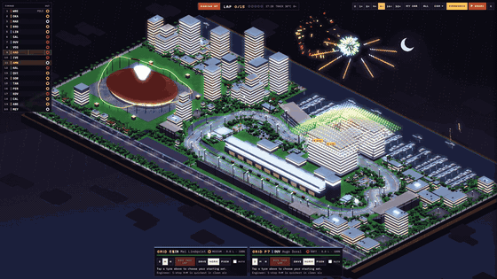

<div align="center">

# sim-diorama

**진짜 규칙으로 돌아가는 작은 3D 세계를 HTML 한 장으로 만들어 주는 Claude Code 스킬**

 

</div>

<br>

## 설치

```bash
git clone https://github.com/D-Sup/sim-diorama-skill.git
cp -r sim-diorama-skill/sim-diorama ~/.claude/skills/
```

<br>

## 쓰는 법

### 1. 만들고 싶은 세계를 말하기

Claude Code에 그냥 말하면 스킬이 켜집니다. 한 줄도 되고, 길게 말할수록 첫 판이 정확해집니다.

```text
하늘섬 위 블록 마을. 블록을 캐고 놓는 게 실제로 계산되고, 밤엔 어두운 곳에만 좀비가 나오게
야경 서킷에서 차 20대가 15바퀴 레이스. 타이어가 닳고 피트 스톱이 단계별로 보이게
비 오는 밤 야시장. 포장마차마다 손님 줄이 진짜로 계산되게
```

결과를 가장 크게 바꾸는 건 아래 두 가지입니다. 이 둘만 말해도 충분합니다.

| | 예 |
|---|---|
| **진짜로 계산될 것** 하나 | 블록 수 장부, 타이어 마모와 피트 전략, 손님 대기 줄 |
| **자세히 보여 줄 장면** 하나 | 집 짓기, 피트 스톱, 음식이 나오는 순간 |

### 2. 질문에 답하기

말하지 않은 부분만 골라서 최대 4개 물어봅니다. 보기 중에 고르면 됩니다.

| 묻는 것 | 예시 답 |
|---|---|
| 화면이 주로 따라갈 대상 | 내 차 / 특정 사람 / 전체를 내려다보기 |
| 참고할 사진·영상·장소 | 영상 첨부 / 실제 장소 이름 / 없음 |
| 꼭 넣을 명소 (실제 장소일 때) | 대표 건물 후보 중 고르기 |
| 분위기 | 노을에서 밤으로 / 비 오는 밤 / 맑은 낮 |
| 용도 | 웹에서 직접 놀기 / 쇼츠 영상 / 둘 다 |

참고 자료가 있으면 구조를 먼저 말로 정리해서 맞는지 확인받고 만듭니다. 귀찮으면 **"알아서 해줘"**라고 하면 됩니다.

실제 작품·상표 이름을 말해도 괜찮습니다. 이름과 로고는 빼고, 느낌만 살린 오리지널로 바꿔 만듭니다.

### 3. 결과 보고 다듬기

다 만들면 HTML 파일 하나가 나옵니다. 브라우저로 열면 바로 돌아갑니다.

머릿속 그림과 다르면 **어느 쪽이 다른지만** 말해 주세요. 그 부분만 고칩니다.

| 다른 곳 | 이렇게 말하기 |
|---|---|
| 크기·카메라 | "차가 너무 작아, 기본 카메라가 내 차를 따라가게" |
| 배경·밀도 | "건물이 거의 없어, 빈 땅이 안 보이게 채워줘" |
| 구조 | "탑이 양쪽에 하나씩 있어야 해" |
| 핵심 장면 | "피트 스톱이 너무 단순해, 정비사가 역할별로 움직이게" |
| 분위기 | "밋밋해, 노을 그림자랑 밤 조명을 더" |
| 화면 정리 | "정보가 흩어져 있어, 중계 화면처럼 정리해줘" |

### 그 밖에

| 이렇게 말하면 | 이렇게 됩니다 |
|---|---|
| "프롬프트만 짜줘" | 만들지 않고 영어 프롬프트만 줍니다. 다른 AI 도구에 붙여 넣어 쓸 수 있습니다. |
| "이 영상 구조 그대로 만들어줘" + 영상 첨부 | 영상에서 구조를 뽑아 확인받은 뒤 만듭니다. |
| "쓰레드에 올리게 세로로도 보여줘" | UI를 숨기고 4:5·9:16으로 보는 공유 모드를 넣습니다. |

<br>

## 구성

```text
sim-diorama/
├── SKILL.md                  전체 흐름
├── references/
│   ├── prompt-recipe.md      프롬프트 템플릿 · 체크리스트 · 예시
│   ├── quality-bar.md        첫 판부터 넣는 품질 기준
│   ├── build-playbook.md     렌더 방식 · 시뮬 구조 · 함정 목록
│   ├── pixel-pipeline.js     픽셀아트 후처리 (외곽선 + 64색)
│   ├── example-*.html        완성작
│   └── example-*-shot.mjs    영상 연출 예시
└── scripts/
    ├── verify.mjs            헤드리스 검증
    ├── record.mjs            프레임 단위 녹화
    └── patch.py              큰 HTML 안전하게 고치기
```

<br>

## 크레딧 · 라이선스

프롬프트 구조는 [vib3coded](https://x.com/vib3coded)의 "Deep End" 디오라마 프롬프트에서 영감을 받았습니다.

MIT License
