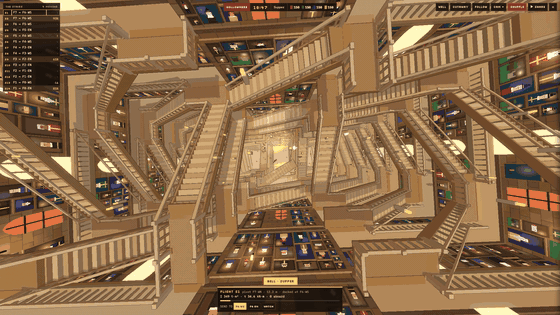
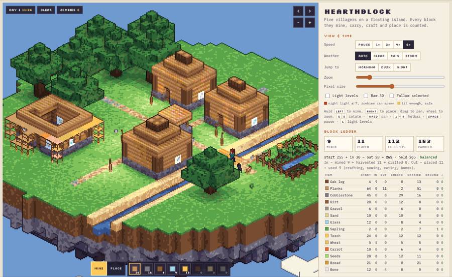

<div align="center">

# sim-diorama

**진짜 규칙으로 돌아가는 작은 3D 세계를 HTML 한 장으로.**

Claude Code 스킬 · three.js · 픽셀아트 아이소메트릭



</div>

<br>

> "해리포터 계단처럼 움직이는 계단이 있는 성 만들어줘"
>
> 이 한 줄로 시작해 위 장면이 나왔습니다. 계단은 정해진 애니메이션이 아니라 무게와 회전 힘으로 계산돼서 돌고, 사람들은 지금 이어진 계단만 골라 길을 찾습니다.

<br>

## 어떻게 만들어지나

| 단계 | 하는 일 |
|:--:|---|
| **1. 묻기** | 비어 있는 것만 최대 4개 묻습니다. 참고 자료, 가장 진짜 같아야 할 움직임, 첫 화면 시점, 용도(웹 / 쇼츠). |
| **2. 구조 확인** | 참고 영상이 있으면 프레임을 뽑아 "반복되는 단위가 이거 맞죠?"를 먼저 확인합니다. |
| **3. 프롬프트** | 7개 덩어리(그림체 · 조작 · 무대 · 진짜 규칙 · 사람 · 낮밤/날씨 · 볼거리)로 영어 프롬프트를 짜서 보여 줍니다. |
| **4. 만들기** | 그 프롬프트대로 HTML 한 장을 직접 만듭니다. |
| **5. 검증** | 헤드리스 브라우저로 낮 → 8배속 → 밤을 돌려 화면과 규칙(장부가 맞는지 등)을 검사합니다. |
| **6. 영상** *(선택)* | 한 프레임씩 찍어서 느린 컴퓨터에서도 끊김 없는 30fps 쇼츠를 만듭니다. |

기존 작품 이름을 말해도 이름·캐릭터·로고는 빼고, 느낌만 살린 오리지널로 바꿔 만듭니다.

<br>

## 만든 것들

### Twilight Marina GP — 야간 F1 레이스

차 20대가 15바퀴를 도는 동안 랩 타임, 타이어 마모, 피트 스톱 손실(약 20초), 언더컷이 전부 실제로 계산됩니다. 순위는 판마다 다릅니다.

**처음 요청**

> 아부다비 야스 마리나 F1 경기장에서 가상의 10개 팀 20대 차량이 15랩 동안 실제 F1 룰에 따라 경주했으면 좋겠어. (…) 특히 피트 스톱이 완벽하게 구현됐으면 좋겠어. (…) 나는 한 팀을 맡아서 피트 타이밍과 타이어를 직접 고르고 싶고 (…) 해 질 녘에서 밤으로 바뀌는 분위기면 좋겠어.

**고친 과정**

| 판 | 실제 요청 | 바뀐 것 |
|:--:|---|---|
| 2 | "건물도 거의 없고 꾸며진 게 없어서 야스 마리나 느낌이 전혀 안 나" | 트랙 위 호텔, 마리나, 테마파크, 관중석, 야자수, 바다 |
| 3 | "확대·축소할 때마다 크기가 바뀌는 게 어색해. 실제 비율로 고정해줘" | 차를 실제 크기(5.6 × 2m)로 고정하고 섬 경계 안을 빽빽하게 채움. 정비사 20명이 단계별로 타이어 교체 |
| 4 | "관중과 정비사가 덩어리로 보여" · "조명이 밋밋해" · "정보가 흩어져 있어" | 사람 리그, 노을 그림자와 밤 조명, 빛 번짐과 물 반사, 중계 화면식 UI, 4:5·9:16 공유 모드 |
| 5 | "불꽃놀이를 계속 터뜨리게 할 수도 있게 해줘" | 아무 때나 켜는 불꽃놀이 버튼 |
| 영상 | "그냥 웹뷰 같은 걸 보여주면서 (…) 다시 전체 맵을 보여주면서 자연스럽게 마치는 영상. 속도는 x8 배속으로" | 웹 화면 그대로 8배속: 전체 맵 → 내 차 → 피트인만 1배속 → 전체 맵 |

이 다섯 번의 수정은 이제 [`quality-bar.md`](sim-diorama/references/quality-bar.md)에 들어 있어서, 새 주제도 첫 판부터 이 수준을 목표로 만듭니다.

- 요청 원문 전체와 스킬이 짠 첫 프롬프트: [`examples/marina-gp.md`](examples/marina-gp.md)
- 완성본: [`example-marina-gp.html`](sim-diorama/references/example-marina-gp.html)

<br>

### Hollowmere — 움직이는 계단의 마법 성

천장에서 수직갱을 내려다보며 내려가는 16초 영상(맨 위 GIF).

구조가 참고 영상과 달라서 네 번 고쳤습니다. 이 경험으로 스킬에 **구조 확인 단계**가 생겼습니다.

고친 내용까지 처음부터 넣은 한글 프롬프트: [`examples/hollowmere-prompt-ko.md`](examples/hollowmere-prompt-ko.md)

<br>

### Hearthblock — 하늘섬의 블록 마을



캐고 놓은 블록 수가 장부에서 항상 0으로 맞아떨어지고, 밤에는 빛이 7 이하인 곳에만 좀비가 나옵니다.

완성본: [`example-hearthblock.html`](sim-diorama/references/example-hearthblock.html)

<br>

## 설치

```bash
git clone https://github.com/D-Sup/sim-diorama-skill.git
cp -r sim-diorama-skill/sim-diorama ~/.claude/skills/
```

검증·영상까지 쓰려면 한 번만 설치합니다(선택). 영상은 [ffmpeg](https://ffmpeg.org/)도 필요합니다.

```bash
cd ~/.claude/skills/sim-diorama
npm install
npx playwright install chromium
```

<br>

## 쓰는 법

Claude Code에 그냥 말하면 됩니다.

```text
움직이는 계단이 있는 성 디오라마 만들어줘
비 오는 밤 야시장. 포장마차마다 손님 줄이 진짜로 계산되게
이 영상 구조 그대로 만들어줘   ← 영상 첨부
프롬프트만 짜줘
쇼츠용 9:16 영상으로도 찍어줘
```

결과가 머릿속 그림과 다르면 **어느 쪽이 다른지**만 말해 주세요. 구조, 움직임, 색·분위기, 시점 중 그 부분만 고칩니다.

<br>

## 구성

```text
sim-diorama/
├── SKILL.md                  전체 흐름
├── references/
│   ├── prompt-recipe.md      프롬프트 템플릿 · 체크리스트 · 예시
│   ├── quality-bar.md        첫 판부터 넣는 품질 기준
│   ├── build-playbook.md     렌더 방식 · 시뮬 구조 · 함정 목록
│   ├── pixel-pipeline.js     픽셀아트 후처리 (외곽선 + 64색)
│   ├── example-*.html        완성작
│   └── example-*-shot.mjs    영상 연출 예시
└── scripts/
    ├── verify.mjs            헤드리스 검증
    ├── record.mjs            프레임 단위 녹화
    └── patch.py              큰 HTML 안전하게 고치기
```

<br>

## 크레딧 · 라이선스

프롬프트 구조는 [vib3coded](https://x.com/vib3coded)의 "Deep End" 디오라마 프롬프트에서 영감을 받았습니다.

MIT License

<br>

---

<sub>**English** — A Claude Code skill that builds a tiny world running on real rules (pixel-art isometric diorama, a genuinely simulated system, people with interlocking routines, day/night and weather) as a single HTML file. It asks a few questions, confirms the structure from your references, writes a 7-part prompt, builds it, verifies it headlessly, and can record a smooth 30 fps short. Install with `cp -r sim-diorama ~/.claude/skills/`. Instructions are in Korean; requests in any language work.</sub>
