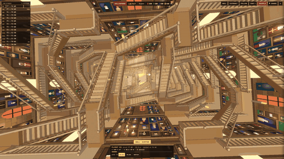

# 예시: Hollowmere — 움직이는 계단이 있는 마법 성



처음 요청은 "해리포터에 나오는 움직이는 계단 성을 만들어줘"였어요. 스킬이 오리지널 이름(Hollowmere)으로 바꿔 만들었고,
참고 영상과 구조가 달라서 네 번 고쳤습니다. 아래는 **고친 내용까지 처음부터 넣은 완성 프롬프트**예요.
스킬 없이 이 프롬프트만 AI 코딩 도구에 붙여 넣어도 비슷한 결과에서 시작할 수 있어요(한 번에 똑같이 나온다고 보장하지는 않아요).

```text
움직이는 계단이 있는 오리지널 마법 성 "Hollowmere"를 three.js 실시간 3D로,
HTML 파일 한 장에 만들어줘. 계단은 애니메이션이 아니라 진짜 계산으로 움직인다.

[1. 구조 — 이것부터 정확히]
- 길고 뚫린 수직갱 양 끝에 네모(ㅁ) 계단탑이 두 개 있다. 각 탑은 가운데가
  위아래로 뻥 뚫린 네모 계단 고리가 층마다 쌓인 모양이다.
- 고리 모서리마다 긴 층계참(C×2C)이 있고, 벽을 따라 걷는 회랑이 같은 층의
  모서리끼리 이어 준다.
- 움직이는 계단은 층계참 안쪽 모서리를 축으로 90도 돈다. 한쪽 멈춤 위치는
  자기 탑의 수직갱 쪽 계단, 다른 쪽은 수직갱을 직각으로 똑바로 건너 반대편
  탑에 닿는 다리다. 수직갱 길이를 계단 하나 길이와 같게 해서, 두 위치 모두
  정확히 한 층을 오르내리게 한다.
- 계단 발 쪽에 경첩 달린 바닥판을 붙여, 어느 각도에서도 층계참과 틈이
  보이지 않게 한다.
- 계단을 많이 두지 말 것. 무작위로 많이 놓으면 서로 막혀 절반은 영영 못
  움직인다. 서로 잠글 수 있는 계단 쌍이 없는 배치를 먼저 찾아서, 모든
  계단이 실제로 움직이게 한다. 간격 검사는 같은 층계참을 쓰는 계단끼리
  끝이 닿으니 양 끝을 1.4m씩 잘라낸 몸체로 한다.

[2. 계단 물리]
- 각가속도 α = τ/I, 관성 I = ML²/3 + Σ m r²(타고 있는 사람 무게 포함).
- 가속은 사다리꼴 적분, 제동은 남은 거리에 맞춰 정확히 멈추게 해서 예상
  시간과 실제 시간이 맞게 한다. 화면 패널에 둘을 같이 보여 준다.
- 축이 닳으면 힘이 줄다가 멈추기 전에 경고(warn)를 띄우고 잠긴다.

[3. 사람]
- 지금 이어진 계단만 보고 길을 찾고, 틈으로는 절대 안 걷는다. 탄 사람은
  난간을 잡고 있다가 계단이 닿은 곳에서 내린다.
- 학생(기숙사 4개, 종소리 시간표), 선생님, 쟁반 나르는 집사, 기름칠하는
  계단지기, 밤 관리인과 고양이. 저녁 18:45~20:30에 계단 위가 가장 붐빈다.

[4. 바깥과 분위기]
- 성은 하늘에 떠 있는 복셀 섬 위에 있다. 2m 격자 기둥, 지층 색 줄무늬,
  뾰족한 아랫면, 호수와 폭포, 나무, 주변에 작은 섬 7개, 빛을 받지 않는 구름.
- 겹치는 면은 높이를 조금씩 다르게 해서 깜빡임(z-fighting)이 없게 한다.
- 수직갱 빈 공간에 촛불 120개가 떠다닌다. 계단을 한꺼번에 섞을 때
  (SHUFFLE) 금빛 가루가 흩날린다.
- 벽에는 액자 초상화, 아치형 문, 벽 촛대, 크림색 난간. 낮·노을·밤, 폭풍.

[5. 카메라와 영상]
- 기본 시점: 천장에서 수직갱을 똑바로 내려다보며 천천히 내려가기
  (카메라 회전 없음).
- 먼 바닥은 안개로 녹인다(안개 시작 14, 끝 70). 영상용은 픽셀 크기 1,
  블룸과 그림자 켬. 화면에 각도 같은 이름표는 넣지 않는다.
- 세로 화면(9:16)은 가로 시야를 기준으로 시야각을 넓혀야 벽이 보인다.
- 영상 모드: 17:30에서 시작, 3배속, 5.4초 뒤 SHUFFLE, 폭풍은 끔.
- 16:9·4:5·9:16 공유 화면, G 키 = 모두 섞기. 이름과 내용은 전부 오리지널로.
```

## 내 세계로 바꿔 쓰기
그대로 두면 좋은 곳 (결과 품질을 지켜 줌)
  - [1] 구조의 "서로 막히지 않는 배치 먼저 찾기", "틈 없는 경첩 바닥판"
  - [2] 물리 전부 (예상 시간과 실제 시간이 맞아야 진짜처럼 보임)
  - [4] 겹치는 면 높이 다르게 (깜빡임 방지)
  - [5] 세로 화면 시야각 규칙, 바닥을 안개로 녹이기

마음대로 바꿔도 되는 곳
  - 성 이름, 사람 역할(학생 → 직원, 손님 등), 붐비는 시간
  - 바깥 배경(하늘섬 → 바닷속, 우주 정거장, 사막 등)
  - 떠다니는 것(촛불 → 반딧불, 등불, 풍선)
  - 섞일 때 효과(금빛 가루 → 별가루, 물방울)

잘 안 나올 때 이렇게 말하면 빨라요
  - 구조가 이상하면: 원하는 모습의 사진·영상을 주고 "반복되는 단위가 뭔지
    먼저 설명하고 만들어" 라고 하기 (영상이면 1초에 2장씩 뽑아 보게 하기)
  - 계단이 안 움직이면: "모든 계단이 실제로 한 번 이상 움직였는지 검사해"
  - 바닥이 깜빡이면: "겹치는 면 높이를 다르게 해"

